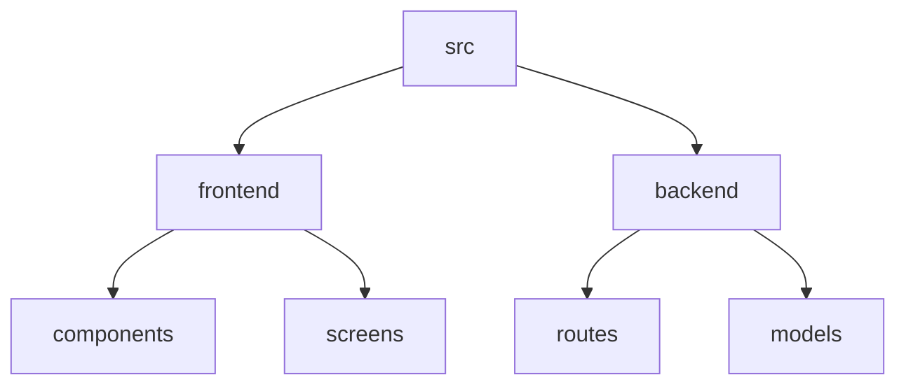

# Biev Main - Social Media Platform

## 🗂️ Description

Biev Main is a social media platform that allows users to create profiles, share posts, follow other users, and interact with each other's content. The platform provides features such as user authentication, post creation, commenting, liking, and sharing. It also includes settings for managing profile visibility, followers, and following lists.

## ✨ Key Features

### **User Management**

* User registration and login functionality
* Profile creation and management
* Profile picture upload and management

### **Post Management**

* Post creation and sharing
* Commenting and liking on posts
* Limited sharing options for posts

### **Social Interactions**

* Following and unfollowing other users
* Viewing and managing followers and following lists

### **Settings and Privacy**

* Profile visibility settings
* Followers and following list visibility settings
* Third-party app access management

## 🗂️ Folder Structure

## 🛠️ Tech Stack

## ⚙️ Setup Instructions

### Prerequisites

* Node.js (version 14 or higher)
* MongoDB (version 4 or higher)
* Git

### Installation

1. Clone the repository: `git clone https://github.com/Kumaraditya18027/Biev_Main.git`
2. Install dependencies: `npm install`
3. Start the backend server: `node index.js`
4. Start the frontend development server: `npm start`

## 📦 GitHub Actions

The repository uses GitHub Actions for continuous integration and deployment. The workflow is defined in the `.github/workflows/main.yml` file.

## 📝 Testing

The repository includes tests for the frontend and backend components. To run the tests, use the following commands:

* Frontend tests: `npm test`
* Backend tests: `node test/index.js`

## 🚀 Deployment

The repository is deployed on a cloud platform. The deployment process is automated using GitHub Actions.

## 🤝 Code of Conduct

The repository follows a code of conduct that ensures a respectful and inclusive environment for contributors. Please see the [CODE_OF_CONDUCT.md](CODE_OF_CONDUCT.md) file for more information.

## 📚 Documentation

The repository includes documentation for the API endpoints, database schema, and frontend components. Please see the [docs](docs) directory for more information.

  

<h3>Kumar Aditya</h3>

Tech enthusiast with a focus on web development, AI, and ML.

 

  <a href="https://gitfull.vercel.app">Made by GitFull</a>

    
